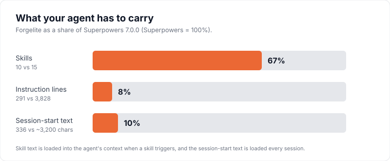
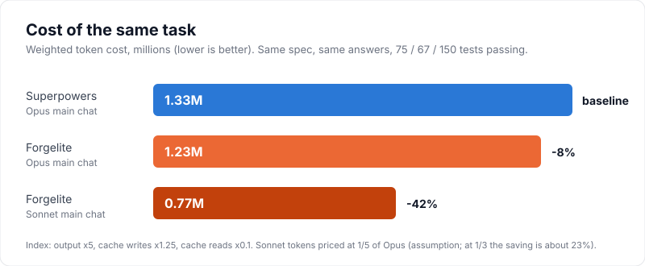
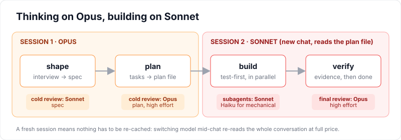

<p align="center">
  
</p>

<p align="center">
  <a href="LICENSE"></a>
  
  
  
</p>

# Forgelite

**A lean, token-efficient build workflow for Claude Code.** Shape an idea into a spec, plan it, build it test-first, debug by evidence, and prove it works before saying "done", while spending expensive model time only where it pays off.

Forgelite is built on the ideas of [**Superpowers**](https://github.com/obra/superpowers) by Jesse Vincent, which showed that a disciplined, skill-driven workflow makes Claude Code far more reliable. Forgelite was made with one goal: **keep that discipline, and improve speed, performance and token usage.** If you like what Superpowers does but want it to cost less and run faster, this is for you.

> Forgelite is not affiliated with Superpowers or its author. See [Credits](#credits).

---

## The short version

|  | Superpowers 7.0.0 | Forgelite |
|---|---|---|
| Skills | 15 | **10** |
| Instruction lines | 3,828 | **295** |
| Text injected at every session start | ~3,200 chars | **336 chars** |
| Independent reviews (spec, plan, final code) | yes | yes |
| Test-first building | yes | yes |
| Model chosen per subagent | mostly inherits your chat's model | **yes** (Haiku, Sonnet or Opus by job) |
| Opus for design and reviews, Sonnet for building | not built in | **built in** |
| Plain-language summaries aimed at non-coders | not a focus | **yes** |

<p align="center"></p>

## Results

We ran the same task three times (Forgelite 0.2.2 against Superpowers 7.0.0; later versions have changed the skills, see [Latest testing](#latest-testing)): build a command-line to-do manager (add, list, edit, done, delete, filters, search, CSV and Markdown export, saved to a file) from the same starter project, with the same spec answers. The starter has a planted bug in its date code that the existing tests do not catch.

<p align="center"></p>

| Run | Weighted cost | Tests passing | Real issues fixed by the final review |
|---|---|---|---|
| Superpowers, Opus main chat | 1.33M | 67 | 2 (3 more left unfixed) |
| Forgelite, Opus main chat | 1.23M (**-8%**) | 75 | 9 |
| Forgelite, Sonnet main chat | 0.77M (**-42%**) | 150 | 6 |

All three met every requirement, and all three found and fixed the planted bug.

**What to read into this, honestly:**

- On the **same model**, Forgelite is only about 8% cheaper. The big saving comes from the model strategy: design and reviews on Opus, building on Sonnet.
- Superpowers can run on Sonnet too, and would save money the same way. Forgelite makes that the default and builds the handover around it (see [Model strategy](#model-strategy)).
- Costs are a **relative index** (output tokens x5, cache writes x1.25, cache reads x0.1), not a bill. Sonnet is priced at 1/5 of Opus, which is an assumption. At 1/3 the Sonnet run saves about 23% instead of 42%. Run `benchmark/scripts/token_report.py` with your own price.
- One run per row, one small project, Windows only. Treat the numbers as a rough size of the effect, not a precise benchmark. The full reports are in [`benchmark/reports`](benchmark/reports) and the method is in [`benchmark`](benchmark).

A larger real-world check: one 14-task feature in a mobile app (a database change, three server functions and four screens) was designed and planned on Opus, then built on Sonnet with 14 subagents. About three quarters of the total cost was Opus (the design chat and its reviews). The whole build phase cost less than the design phase alone. The plan review found 15 problems and the final review found 2 real bugs, all fixed before anything reached a device.

## Latest testing

Forgelite is under constant testing. I run it on a real app with the newest Claude models, read what it cost and where it slipped, and fix it in the next version. **Please always install the latest version** (`claude plugin update forgelite@forgelite`).

**Test 1: version 0.4.2, one real feature, design and plan on Opus, build on Sonnet**

A mobile app got two new features in one go (one database change, one data-loading script, 13 tasks).

| Phase | Cost index | Notes |
|---|---|---|
| Design and plan (Opus) | 1.68M | Plan review found 9 real problems before any code was written |
| Build and review (Sonnet main, 14 subagents) | 2.08M | 423 test suites, 9,468 tests passing, typecheck and lint clean |

**What went well**
- The final Opus review ran by itself and found 1 medium and 2 low bugs (one could have saved a wrong value for the day). All fixed.
- `forgelite:verifying` ran at the end, as it should.
- No build task went past about 49 tool calls (the previous test had 73).

**What we found, and fixed in 0.4.3**
- Three build tasks ran on Opus and cost about a third of the build. Now Sonnet by default; Opus only for migrations, security and payments, with the reason in the plan.
- One task was built on Opus, then rebuilt on Sonnet. A failed task is now continued by the same agent, never rerun on another model.
- Two tasks were merged into one subagent and went over the size target. Now one task per subagent.
- The main build chat grew to over 250k tokens. It now works in batches (see 0.4.4 below).

Numbers are a relative cost index, not a bill; see [Results](#results) for how it is calculated.

**Test 2: version 0.4.3, a bigger new feature in a mobile app (19 tasks)**

Total cost index 9.3M (design 3.9M, build 5.4M), about 0.49M per task against 0.29M in the first test.

- **Went well:** Opus ran only the database task and the final review. The plan review found 12 problems. The final review found 5 real bugs (including a timing bug that made something run several times too fast). 9,756 tests passing.
- **Found, fixed in 0.4.4:** the build chat grew to 418k tokens and cost the most of any part (now batches of 8 tasks); 8 of 19 tasks were too big and needed a second agent (the plan reviewer now checks task size); two parallel agents overwrote each other's files (tasks that share a file now run in sequence); a timed loop kept waking the huge chat (no `/loop` during builds).

**Test 3: version 0.5.0, a fix round on an existing feature in a mobile app (about 16 tasks)**

Total cost index 4.4M (design and plan 2.3M, build in two batches 0.8M and 1.3M), about 0.3M per task against 0.49M in test 2.

- **Went well:** the 8-task batches worked. The two build chats stayed at 132k and 168k tokens (test 2 reached 418k), and the main build chat cost fell from 1.6M to 0.26M. Every task ran on Sonnet, the biggest took 28 tool calls, none needed a second agent, and tasks that shared files ran one after another with no clashes. The plan review found 16 problems and the final review found 6, all fixed. 9,881 tests passing.
- **Found, fixed in 0.5.1:** the design chat became the biggest cost (65 calls on Opus, 241k tokens, 1.6M). Once the spec is approved, planning now moves to a fresh Opus session, after checking every decision is written in the spec.

**Test 4 (latest): versions 0.5.0 and 0.5.1, two features in a mobile app (6 and 7 tasks)**

One was a privacy clean-up when an account is deleted. The other was a daily limit on a paid feature, shaped, planned and built in three fresh sessions.

- **Went well:** the new review skills ran in order and the Opus reviews found real bugs with reproductions: auth tokens leaking into crash reports, a timeout that could hang an hourly job, and a way for a modified app to switch the daily limit off. Each phase handed over to a fresh session, and the plan review caught 3 problems that would have broken the build.
- **Found, fixed in 0.5.2:**
  - A 6-task build done inside the main chat reached 287k tokens. The main chat now only coordinates, every task goes to a subagent, and the chat hands over at about 150k.
  - `verifying` was skipped when the prompt ended with "then push". It now always runs first.
  - The limit hole got past both the spec and plan reviews. Every reviewer now treats a limit, price or permission decided by a value the app sends as Critical.
  - The security fix was not reviewed again, so fixes touching security, money or limits now get a second review of just the fix.
  - The plan was never committed, so specs and plans are now committed once approved.
  - Rollout questions ran on in the build chat at 150-200k tokens. `finishing` now lists the rollout steps and points to a fresh session, and keeps a long-running phase branch without asking.

**Test 4 (latest): version 0.5.2, a new feature in a mobile app (14 tasks, a database change and a data-import script)**

Total cost index 4.5M (spec 0.7M, plan 1.3M in a fresh session, build 2.5M), about 0.33M per task.

- **Went well:** the spec and the plan each ran in their own fresh session. The spec review found 1 critical and 3 important problems, the plan review 12, and the final review 8 (7 fixed, 1 left with a reason). The planner spotted unrelated uncommitted changes and set them aside instead of mixing them in. No subagent went over 28 tool calls. All 476 test suites passing.
- **Found, fixed in 0.5.3:** the build chat ignored the 8-task batch rule and ran all 14 tasks, the review and its fixes in one chat. It filled up and could not answer a simple question afterwards. The plan now carries STOP lines after every batch, the final review runs in its own fresh session, and review fixes go to a subagent.

## Install

```bash
claude plugin marketplace add Harriszed/forgelite
claude plugin install forgelite@forgelite
```

Restart Claude Code. To update later, run `claude plugin update forgelite@forgelite`. If you have Superpowers installed, **disable it** while you use Forgelite. They solve the same problem and compete for control:

```bash
claude plugin disable superpowers@superpowers-dev
```

Forgelite starts itself: a tiny session-start hook (336 characters) tells Claude to use `forgelite:starting-work` before any task that adds, changes or fixes code. Quick questions and one-line fixes are skipped.

## How it works

<p align="center"></p>

| Skill | What it does |
|---|---|
| `forgelite:starting-work` | Reads your project's `CLAUDE.md` first (its rules always win), then routes to the right skill. |
| `forgelite:shaping` | Interviews you one question at a time, offers improvement ideas for you to accept or reject, writes the spec, has it cold-reviewed. |
| `forgelite:planning` | Turns the spec into small test-first tasks, has the plan cold-reviewed by Opus at high effort, shows you a 5-line summary. |
| `forgelite:building` | Builds test-first, runs independent tasks as parallel subagents on the cheapest model that can do the job, then a final Opus review that runs the code with awkward input. |
| `forgelite:debugging` | Reproduce, gather evidence, one hypothesis at a time, failing test, fix the cause. Stops after three failed fixes. |
| `forgelite:verifying` | No "done" without real command output from this session. Ends with exactly what you should check next. |
| `forgelite:worktrees` | Sets up an isolated git worktree with dependencies installed and a clean test baseline, when your checkout should stay untouched. |
| `forgelite:requesting-review` | One cold Opus review of the branch diff against the spec and plan, with a fixed brief, tool-call limit and ranked report. |
| `forgelite:receiving-review` | Checks every finding against the code before changing anything: fixes real ones test-first, pushes back on wrong ones with evidence. |
| `forgelite:finishing` | After verifying passes, you choose: open a PR, merge locally, keep the branch or discard it. Then it cleans up the worktree. |

### Model strategy

| Job | Model | Why |
|---|---|---|
| Interview, spec, plan | Opus (your chat) | Mistakes here are the expensive ones. |
| Spec review | Sonnet | A scoped read-and-report job. |
| Plan review | Opus, high effort | The last gate before work starts. |
| Build tasks | Sonnet (Haiku for pure mechanical edits, never tests). Opus only for migrations, security and payments, with the reason in the plan | The plan already holds the thinking. |
| Final code review | Opus, high effort | The last gate before you see it. |

A skill cannot change your chat's model, so when the plan is approved Forgelite tells you to **open a new Sonnet session** and say `build the plan at <path>`. This is deliberate: switching model mid-chat makes the new model re-read (and re-cache) the whole conversation at full price, and a builder does not need the design discussion anyway. The plan file is the handover.

### Token habits built in

- Every reviewer gets an exact file list, a tool-call limit and a word limit, so it cannot wander through your repo.
- Every build subagent must reply in under 150 words, so reports do not fill your main chat.
- Subagents are meant to stay around 200-300k tokens of context. Tasks are sized to fit, and a subagent that is not nearly done writes a handover file for a fresh one.
- One task per subagent, never merged, and a failed task is continued by the same agent, never rerun on another model.
- Builds run in batches of at most 8 tasks, then a progress note and a fresh session, so the chat never grows huge. Tasks that share a file never run in parallel, and parallel tasks run only their own tests.

## What Forgelite leaves out

Forgelite now has its own worktree, finish-branch and code-review (request and receive) skills, written short. It still does **not** include Superpowers' parallel-agent dispatch skill, its skill-writing skill or its other meta skills: parallel subagents are built into `forgelite:building` instead. If you rely on those, keep Superpowers for them.

## Works with your project

Forgelite reads `CLAUDE.md` before anything else and never overrides it. If your project already has a process (design docs, review steps, end-of-phase checklists, a different specs folder), Forgelite follows it and only fills the gaps. Specs and plans go in `docs/forgelite/specs` and `docs/forgelite/plans` unless your repo already uses another folder.

## Reproduce the benchmark

```bash
cd benchmark/task-list-starter       # the starter project, TASK.md and ANSWERS.md
```

1. Copy `task-list-starter` into a fresh folder and `git init` it. Do this once per run.
2. Open a new Claude Code session there with the plugin you want to test enabled and the other disabled.
3. Paste the contents of `TASK.md`. The agent answers its own questions from `ANSWERS.md`.
4. It writes a `RUN-REPORT.md` (template included).
5. Measure it: `python -I benchmark/scripts/token_report.py "*your-project-folder*" --sonnet-price 0.2`

## Limitations

- Measured on small projects, one run each, on Windows with Node. Real projects will differ.
- The session-start hook is a small `printf` run through bash. It works in Git Bash on Windows and on macOS and Linux, but has only been tested on Windows.
- The token index is relative, and the Sonnet price ratio is an assumption.
- Forgelite is opinionated about models. If you do not use Opus, Sonnet and Haiku, adjust the model names in the skills.

## Credits

Forgelite exists because of [**Superpowers**](https://github.com/obra/superpowers) by Jesse Vincent (obra), MIT licensed. The workflow shape (brainstorm, plan, test-first build with subagents, systematic debugging, verification before completion) comes from his work, and so does the idea of making agent discipline a set of composable skills. Forgelite's text is written from scratch and condensed, with a different model strategy, but it would not exist without his. Please go and star the original.

## License

MIT. See [LICENSE](LICENSE) and [NOTICE](NOTICE).
